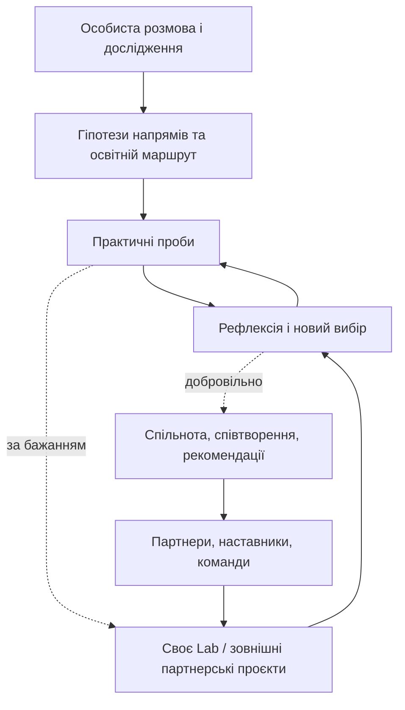

# 01. Візія та екосистема «Своє»

**Статус:** робоче стратегічне бачення · **Оновлено:** 15.10.2026. [← Зміст](README.md)

## 1. Для чого існує «Своє»

**Публічна місія:** допомагати підліткам знаходити напрями, де можуть поєднатися інтереси, сильні сторони, користь людям, можливість розвитку й перспектива гідного заробітку; перевіряти гіпотези реальними невеликими діями.

**Людська перспектива:** важливо не «призначити професію», а дати людині більше розуміння себе, авторства рішення та свободи розвивати власний шлях. Цілісність — філософське підґрунтя, **не психотерапевтична обіцянка**.

**Коротка бренд-обіцянка, наявна на сайті:** **«Знайди свій напрям. Перевір його в дії».**

## 2. Від послуги до екосистеми

**Фактично є:** індивідуальна робота з першими родинами; сайт з поясненням підходу, знеособленими прикладами й відкритими мікропробами (10–20 хвилин) та рефлексією в поточній вкладці браузера. 

**Напрям розвитку:** після персональної роботи створити необов'язковий шлях підтримки практичних проб і доступу до людей/проєктів через «Своє Lab» та партнерську мережу.

**Не створено як готовий продукт:** повноцінний особистий кабінет тривалого супроводу; системна мережа практичних стажувань; регулярна програма Lab. Публічно не обіцяти доступність до фактичного запуску.

## 3. П'ять контурів екосистеми

| Контур | Кому корисний | Яку цінність створює |
| --- | --- | --- |
| Персональне дослідження | Підлітку та родині | Зрозумілі гіпотези, логіка вибору, освітні й економічні орієнтири |
| Практичні проби | Підлітку | Досвід реальної діяльності замість висновків лише з тестів |
| Супровід і рефлексія | Тим, кому важко перейти до дії | Посильна структура, зворотний зв'язок без примусу |
| «Своє Lab» | Добровільним учасникам | Навчальні проєкти, поступовий перехід до оплачених завдань |
| Партнери та спільнота | Учасникам, наставникам і організаціям | Реальні задачі, зв'язки, спільні результати та обмін досвідом |

## 4. Стратегічні принципи

- **Авторство вибору:** підліток може не погодитися з гіпотезою, змінити рішення або не долучатися до Lab.
- **Жодного ярлика:** інтереси й сімейний досвід — джерела запитань, не психологічна діагностика чи прогноз долі.
- **Опціональність:** пропонувати декілька обґрунтованих маршрутів, не звужувати можливості інтерпретацією консультанта.
- **Проби перед великим рішенням:** мале безпечне експериментування, потім рефлексія і корекція плану.
- **Користь обом сторонам:** практична робота не маскується під «безоплатне навчання»; справедливі умови й права учасників.
- **Доказовість:** відокремлювати задоволеність, усвідомлення, намір і підтверджену поведінку.
- **Приватність:** особисті історії дітей не є автоматично рекламним активом.

## 5. Довгостроковий критерій успіху

Не кількість створених звітів або слайдів, а частка учасників, які за власними словами отримали краще розуміння напрямів, спробували принаймні одну добровільну пробу та можуть осмислити її для наступного вибору. Це **пропозиція метрик**, не доведений ефект «Своє».

**Пов'язані документи:** [продукти](03-product-architecture.md) · [Lab](05-svoye-lab.md) · [докази цінності](06-growth-and-evidence.md).
